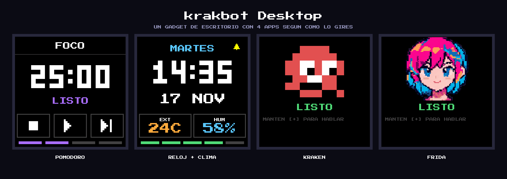
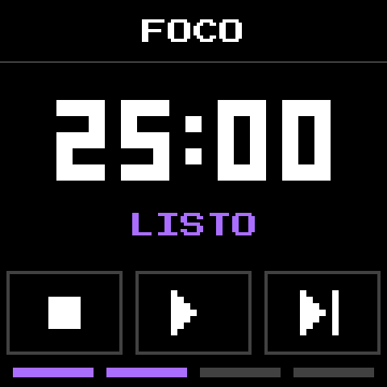
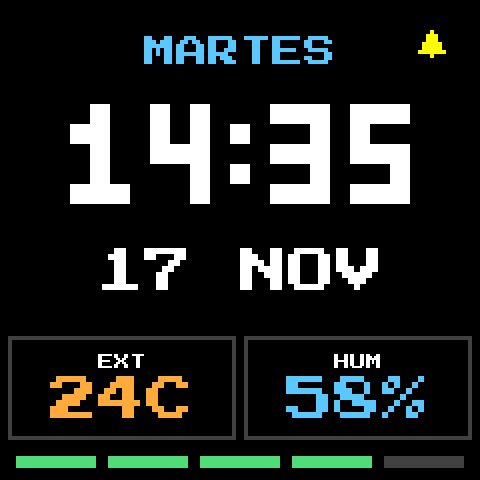
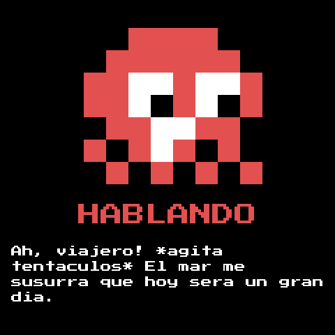
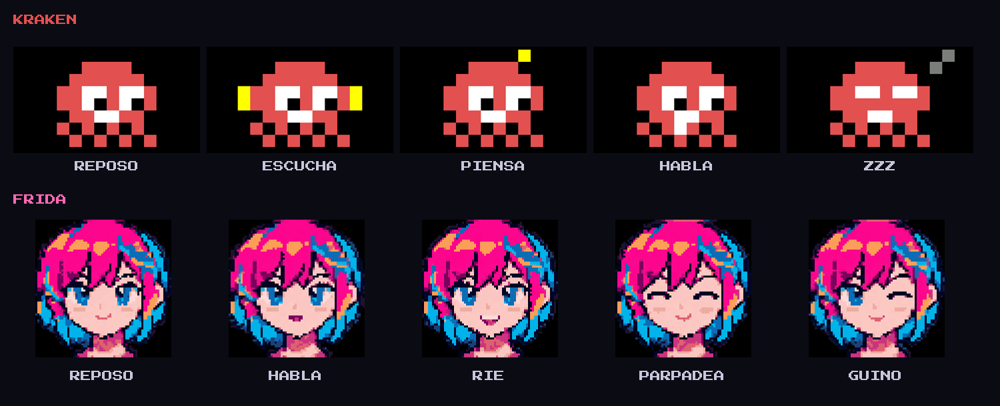

<h1 align="center">krakbot Desktop</h1>

<p align="center">
  
</p>

<p align="center">
  Un gadget de escritorio a batería con estética 8-bit: <b>girás la placa y cambia de app</b>.<br>
  Hecho para la <b>Waveshare ESP32-S3-Touch-LCD-1.54</b> (acelerómetro QMI8658, micrófono y parlante).
</p>

> Las capturas de este README son maquetas dibujadas con las mismas medidas que el firmware, no fotos de la placa.

## Cómo funciona

El acelerómetro detecta cómo está la placa y elige la app:

| Posición | App |
|---|---|
| Vertical (botones arriba) | **Pomodoro**: foco / descanso / pausa larga, táctil + botones + sonidos |
| Giro 90° a la izquierda | **Reloj**: hora (NTP), clima exterior (Open-Meteo, Rosario), batería, campanita por hora |
| Giro 90° a la derecha | **Agente de voz**: hablás y un personaje te contesta (Kraken o Frida) |
| Acostada, pantalla arriba | Pantalla apagada (ahorro de batería). En el agente de voz nunca se apaga sola |

## Las apps

<table>
  <tr>
    <td align="center"><br><b>Pomodoro</b><br>25 / 5 / 15 min, 4 bloques por set</td>
    <td align="center"><br><b>Reloj + clima</b><br>hora, fecha, temperatura y humedad exterior</td>
  </tr>
  <tr>
    <td align="center"><br><b>Kraken</b><br>pulpo pixelado, voz de nene juguetón</td>
    <td align="center"><br><b>Frida</b><br>pícara y coqueta, voz joven</td>
  </tr>
</table>

## Los personajes

<p align="center">
  
</p>

Cada uno tiene su propia voz, su personalidad (su propio flujo de n8n) y se cambia manteniendo `BOOT`.
Se animan en reposo, escuchando, pensando, hablando, error y dormido.

<p align="center">
  
</p>

## Puesta en marcha (paso a paso)

Solo hace falta la **Waveshare ESP32-S3-Touch-LCD-1.54**, un cable USB-C y, para el agente de voz, tres cuentas
(todas tienen capa gratuita o pago por uso): Groq, OpenAI y un n8n propio.
El Pomodoro, el reloj y el clima funcionan solo con el Wi-Fi; las claves de abajo son solo para el agente.

1. **Instalá [PlatformIO](https://platformio.org/)** (extensión de VS Code o `pip install platformio`).
2. **Clonar y crear tus secretos.** `src/secrets.h` está en `.gitignore`: nunca se sube al repo.
   ```sh
   git clone https://github.com/DiegoBoni/krakbot-desktop.git
   cd krakbot-desktop
   cp src/secrets.example.h src/secrets.h
   ```
3. **Completar `src/secrets.h`** (ver la tabla de abajo).
4. **Importar los flujos de n8n** y copiar sus URLs a `secrets.h` (ver [Flujos de n8n](#flujos-de-n8n-uno-por-personaje)).
5. **Compilar y subir** con la placa conectada por USB:
   ```sh
   pio run -t upload
   ```
   PlatformIO detecta el puerto solo. Si no, pasale `--upload-port /dev/cu.usbmodemXXXX` (Mac/Linux: `ls /dev/cu.usb*`).
   Si la placa no aparece, mantené `BOOT`, apretá reset (o reconectá el cable) y soltá `BOOT`.
6. Girá la placa a la derecha: si falta algo, el agente lo dice en pantalla (ver [Problemas frecuentes](#problemas-frecuentes)).

### Qué va en `src/secrets.h`

| Define | Qué es | Dónde se obtiene | ¿Obligatorio? |
|---|---|---|---|
| `WIFI_SSID` / `WIFI_PASS` | Tu red Wi-Fi **de 2,4 GHz** (la placa no usa 5 GHz) | tu router | Sí (hora, clima y agente) |
| `GROQ_API_KEY` | Transcripción de voz, empieza con `gsk_` | https://console.groq.com/keys | Para el agente |
| `OPENAI_API_KEY` | Voz de la respuesta (TTS), empieza con `sk-` | https://platform.openai.com/api-keys | Para el agente |
| `N8N_WEBHOOK_URL` | URL de producción del webhook de Kraken | n8n, ver abajo | Para el agente |
| `N8N_WEBHOOK_URL_FRIDA` | URL del webhook de Frida; si queda vacío, Frida usa el de Kraken | n8n, ver abajo | No |

Dejá entre comillas, sin espacios, y no subas nunca este archivo. Las claves quedan grabadas en la memoria
flash de la placa: si la prestás o la regalás, borrala (`pio run -t erase`) o rotá las claves.
Si alguna vez pegaste una clave en un chat, un issue o un commit, regenerala.

## Flujos de n8n (uno por personaje)

El agente no habla directo con un modelo de lenguaje: manda el texto a un **webhook de n8n**, donde vive la
inteligencia (modelo, memoria, herramientas) y la **personalidad**. Así podés cambiar cómo piensa y habla cada
personaje sin tocar el firmware.

| Skin | Flujo para importar | Path del webhook | Define |
|---|---|---|---|
| Kraken | [`n8n/krakbot-workflow.json`](n8n/krakbot-workflow.json) | `/webhook/krakbot` | `N8N_WEBHOOK_URL` |
| Frida | [`n8n/frida-workflow.json`](n8n/frida-workflow.json) | `/webhook/frida` | `N8N_WEBHOOK_URL_FRIDA` |

Los JSON **no traen credenciales**. Para cada uno:

1. En n8n: **Workflows → Import from file** y elegí el JSON.
2. Asigná tus credenciales en los nodos que las piden:
   - **OpenAI Chat Model**: una credencial *OpenAI API* (puede ser la misma clave de arriba).
   - **MCP Client** (opcional, ver [Composio](#herramientas-con-composio-opcional)): una credencial *Header Auth*.
3. En el nodo **AI Agent → Options** poné *Max Iterations* en `15` (ya viene así en el JSON; sirve para que alcance a usar herramientas).
4. Activá el workflow (interruptor **Active**). Sin eso solo responde la URL de prueba.
5. Abrí el nodo **Webhook** y copiá la **Production URL** (`https://TU-N8N/webhook/krakbot`), **no** la de
   `webhook-test`, en `src/secrets.h`.

Probalo antes de tocar la placa:

```sh
curl -s -X POST https://TU-N8N/webhook/krakbot \
  -H 'Content-Type: application/json' -d '{"message":"hola, quién sos?"}'
# -> {"text":"..."}
```

**Contrato** (por si querés armar tu propio flujo): el firmware hace `POST` con `{"message": "..."}` y espera
`{"text": "..."}` (también acepta `output`, `response`, `message` o `reply`, o texto plano). Tiene hasta 60 s de espera.
Las respuestas se **recortan a 320 caracteres** (se corta en el último punto) para que el audio siempre entre en memoria,
y el prompt ya le pide al modelo no pasar de 300.

**Seguridad:** el webhook no lleva autenticación; la URL es el secreto. Usá un path difícil de adivinar
(por ejemplo `/webhook/krakbot-a83f1c`) y no la publiques. Si la filtrás, cambiá el path y volvé a activar el flujo.

### Cambiar la personalidad
Está en el *System Message* del nodo **AI Agent** de cada flujo (el texto empieza con `=Sos Kraken...` o `=Sos Frida...`).
Ese mensaje tiene tres partes: la personalidad, un párrafo `HERRAMIENTAS` (cómo usar Composio) y un párrafo
`FORMATO DE LA RESPUESTA` (la respuesta se lee en voz alta: sin listas ni links). El `=` inicial es necesario
para que se calcule la fecha y hora de Argentina que aparece al final; si lo borrás, el agente verá el texto `{{ ... }}`.
Para sumar un tercer personaje, duplicá un flujo, cambiá el path y el prompt, y agregá un skin en `src/agent.cpp`.

### Herramientas con Composio (opcional)
El nodo **MCP Client** conecta el agente con [Composio](https://composio.dev) para que pueda mirar tu Gmail, tu agenda,
Drive, Notion, etc.

1. Creá una cuenta en Composio y conectá las apps que quieras.
2. En n8n creá una credencial **Header Auth** con la clave que te da Composio para su servidor MCP
   (`https://connect.composio.dev/mcp`) y asignala al nodo **MCP Client**.
3. El prompt ya le explica cómo usarlo: busca la herramienta (`COMPOSIO_SEARCH_TOOLS`), la ejecuta
   (`COMPOSIO_MULTI_EXECUTE_TOOL`), pide confirmación antes de enviar o borrar algo y resume en voz.

Si no lo querés, **borrá el nodo MCP Client y el párrafo `HERRAMIENTAS` del prompt**; si no, el agente
prometerá cosas que no puede hacer. Con herramientas las respuestas tardan más (hasta ~20-30 s).

## Voces y personajes
Los skins (aspecto, voz y estilo) están en la tabla `SKINS` de `src/agent.cpp`:

| Skin | Voz de OpenAI | Carácter |
|---|---|---|
| Kraken | `echo` | voz de nene aguda, chistosa y juguetona |
| Frida | `nova` | voz de chica joven, simpática y pícara |

Cada entrada tiene la voz, unas instrucciones de estilo para el modelo `gpt-4o-mini-tts` y dos campos de
efecto opcionales (`robotMix`, `crush`; en 0 la voz sale limpia). El volumen general se cambia desde la pantalla
(ver Controles) y `TTS_GAIN` en `agent.cpp` es el volumen base de la voz.
Las conexiones HTTPS validan certificados con el bundle de CA del core, por eso necesitan la **hora NTP**: sin Wi-Fi
al arrancar el agente falla con error de conexión.

El retrato de Frida sale del atlas `assets/frida_atlas_v2.webp` (3×3: ojos abiertos / cerrados / guiño × boca cerrada /
chica / risa). Para cambiarlo, reemplazá la imagen y corré `python3 tools/make_avatar.py` (genera `src/avatar_data.h`).

## Controles

### En todas las apps
| Gesto | Acción |
|---|---|
| Arrastrar un dedo hacia arriba / abajo | **Volumen general** (aparece una barra a la derecha; se recuerda al apagar) |
| Tocar `PWR` | Apaga / enciende la pantalla (tocarla también la despierta) |
| Mantener `PWR` | Apaga la placa (con USB conectado queda en reposo profundo; `PWR` la despierta) |
| Girar la placa | Cambia de app con una animación de transición |

La pantalla baja el brillo a menos de la mitad tras 20 s sin tocarla; cualquier toque o botón lo devuelve
(el toque que la despierta no activa nada).

### Por app
- **Pomodoro**: `+` inicia/pausa (mantener: reset); `BOOT` cambia de modo / salta bloque. También es táctil.
- **Reloj**: `+` campanita por hora; `BOOT` ciclo de brillo.
- **Agente de voz**: ver la tabla.

| Control | Acción |
|---|---|
| Mantener `+` | Grabar (hasta 15 s); soltar para enviar |
| Tocar `+` mientras habla | Interrumpe la respuesta |
| `BOOT` en reposo | Historial: última charla; cada toque va a una más vieja |
| `BOOT` ocupado | Cancela el turno actual |
| Mantener `BOOT` (0,7 s) | Cambia de skin (aspecto + voz); se recuerda al reiniciar |
| Tocar la pantalla | Despierta del modo ZZZ (a los 45 s sin uso) y el personaje reacciona; sale del historial |
| Arrastrar en el historial | Scroll del texto (acá no cambia el volumen) |

Cómo es un turno: 1) Groq (`whisper-large-v3-turbo`) transcribe; 2) el texto va al webhook de n8n;
3) OpenAI TTS (`gpt-4o-mini-tts`) lo dice en voz alta mientras el personaje mueve la boca.
El historial guarda las últimas 8 charlas en memoria (se pierden al reiniciar). El Wi-Fi se mantiene mientras estés
en esta pose y se apaga tras 60 s sin uso.

## Problemas frecuentes

| Síntoma | Causa probable |
|---|---|
| "FALTAN CLAVES EN SECRETS.H" | Falta `GROQ_API_KEY`, `OPENAI_API_KEY` o `N8N_WEBHOOK_URL`; completá y volvé a subir |
| "SIN WIFI" | Red de 5 GHz, SSID/clave mal escritos o router lejos |
| "MUY CORTO" / "NO TE ENTENDI" | Grabación de menos de 0,5 s o en silencio; apretá `+`, esperá un instante y hablá cerca de la placa |
| "SIN RESPUESTA" | El flujo de n8n no está **Active**, usaste la URL `webhook-test`, o el flujo falló: mirá *Executions* en n8n |
| Error al transcribir | `GROQ_API_KEY` inválida o sin cupo |
| Responde pero no suena | `OPENAI_API_KEY` inválida o sin saldo; revisá el volumen (arrastrá hacia arriba) |
| Contesta "no puedo acceder a tus mails" | Falta el nodo MCP Client / Composio, o el prompt no tiene el párrafo `HERRAMIENTAS` |
| No sube el firmware | Cable solo de carga, o placa sin enumerar: reconectá o usá `BOOT` + reset |

Para ver qué pasa por dentro: `pio device monitor` (115200) muestra la transcripción, el código HTTP de n8n y de OpenAI, y la memoria libre.

## Hardware
- LCD ST7789 240x240 por SPI; en rotaciones 2/3 necesita offset de 80 px.
- IMU, táctil CST816 y codec ES8311 comparten el bus I2C (SDA 42, SCL 41).
- Botones: `BOOT` GPIO0, `+` GPIO4, `PWR` GPIO5 (activos en bajo).
- GPIO2 debe estar en alto para mantener la alimentación a batería (bajarlo la corta); la tensión de batería se lee en GPIO1 (divisor 1:3).
- `src/es8311.*` y `src/es7210.*` (micrófono) vienen de los ejemplos de Waveshare.
- Micrófono ES7210 y parlante ES8311 comparten el bus I2S (MCLK 8, BCLK 9, LRC 10, DIN 11, DOUT 12).

## Batería
CPU a 80 MHz (160 solo con el Wi-Fi encendido), brillo reducido tras 20 s sin tocar, Wi-Fi apagado salvo al refrescar el
clima (cada 10 min) o en la pose del agente, y pantalla apagada boca arriba. El brillo se cambia con `BOOT` en el reloj.

## Imágenes del README
Se generan con `PRESS_START_2P=/ruta/PressStart2P-Regular.ttf python3 tools/render_readme_images.py`
(fuente [Press Start 2P](https://fonts.google.com/specimen/Press+Start+2P), licencia OFL).
